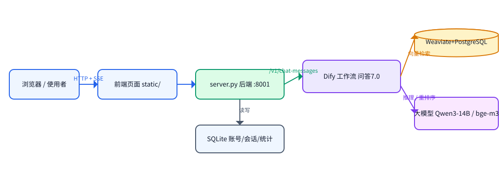
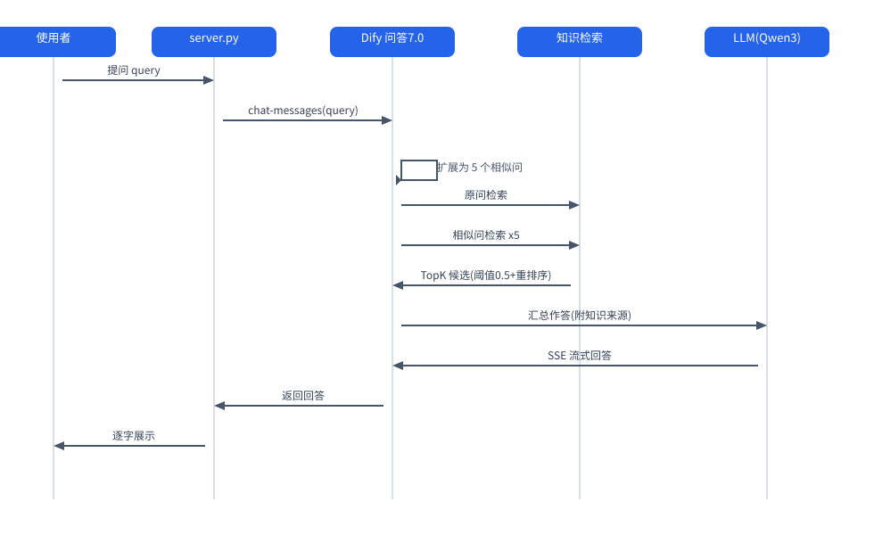
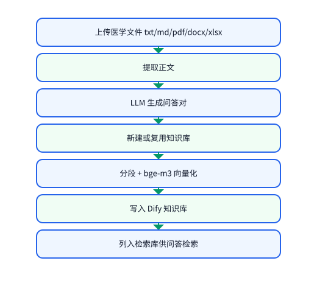

# 医学知识智能问答系统 · 本地前后端

基于 Dify 与 RAG 的医学知识智能问答系统。本文档说明项目的**依赖清单、使用的工具与技术栈、涉及的大模型，以及如何开启前后端服务**。

- 当前接入的工作流：**问答7.0**（Dify 应用标识 `6cba9257d8`）
- 服务地址：http://127.0.0.1:8001
- 适用平台：Windows（同时提供 macOS / Linux 的 `.sh` 脚本）

> 目录名为 `medical-qa-50` 属历史遗留（早期版本叫问答 5.0），实际运行的是问答7.0，不影响使用。
>
> ⚠️ **本项目不修改 Dify 工作流的任何内容。** 知识库管理全部走 Dify 的 Service API（`/v1/datasets/**`），只读写知识库数据；工作流图（节点、连线、提示词）完全由使用者在 Dify 中自行维护。

---

## 一、项目简介

本项目是一个**轻量的本地 Web 服务**，为 Dify 上的"医学知识智能问答"工作流提供用户界面与代理层。它自己不含任何 AI 能力，所有检索与生成都调用本机部署的 Dify 完成。

系统分为两部分：

| 部分 | 说明 | 位置 |
| --- | --- | --- |
| 后端服务 | 账号会话、请求代理、知识库管理、上传转发、SSE 流式转发 | `server.py` |
| 前端页面 | 对话界面、知识库管理界面、接口设置、统计看板 | `static/` 目录 |

**后端与前端由同一个进程提供**：`server.py` 启动后既处理 `/api/*` 接口，也把 `static/` 下的页面托管在根路径。因此只需启动一个服务，浏览器访问即可同时得到前端页面和后端能力。

系统的三层结构：

| 层次 | 组件 | 职责 |
| --- | --- | --- |
| 展示层 | 原生 HTML / CSS / JavaScript | 对话、知识库管理、接口设置、统计 |
| 服务层 | `server.py`（Python 标准库） | 鉴权、代理转发、数据落库、流式透传 |
| 平台层 | Dify 1.17.1 + 大模型服务 | 工作流编排、知识检索、答案生成 |

#### 系统架构与流程图

> 下图展示本系统与 Dify 平台的分层关系，以及「一次问答的检索链路」和「知识库入库链路」。

**系统架构**



**一次问答的检索链路**



**知识库入库链路**



### 1.1 与其他项目的关系

本机存在两份功能相近的项目，请注意区分：

| 目录 | 服务端口 | 接入的 Dify 应用 |
| --- | --- | --- |
| `D:\study_10_10\medical-qa-50`（本项目） | **8001** | 问答7.0 |
| `D:\study_10_10\medical-qa` | 8000 | 智能问答02（早期版本） |

两者是姊妹项目，代码结构类似；本项目额外支持**上传知识文件 → 自动生成问答对 → 写入知识库**，以及**知识库在线管理**。两份项目可同时运行，互不干扰（端口不同，各自使用独立的 `data/` 数据目录）。

---

## 二、目录结构

```
medical-qa-50/
├── server.py                 后端服务主程序（单文件，零依赖）
├── config.json               配置：端口、Dify 连接、应用密钥
├── config.example.json       配置模板（不含真实密钥）
├── start.bat / start.sh      启动服务
├── stop.bat  / stop.sh       停止服务
├── restart.bat / restart.sh  重启服务
├── 打包分发.bat              一键打包为可分发压缩包
├── static/                   前端页面（由 server.py 托管）
│   ├── index.html            页面骨架
│   ├── style.css             样式
│   ├── app.js                对话主逻辑、SSE 接收、来源渲染
│   ├── kb.js                 知识库管理（列表 / 文档 / 分段 / 归档）
│   └── stats.js              统计看板
├── data/                     运行数据（自动生成）
│   ├── app.db                SQLite：用户、会话、消息、统计
│   └── server.pid            进程号（供 stop 脚本定位）
├── dev/                      开发与诊断脚本（不参与运行）
├── tools/package.py          打包脚本
├── verify.sh                 端到端验收脚本
├── verify_kb.py              知识库自检
├── verify_apps.py            应用连接自检
├── verify_archive.py         归档功能自检
├── README.md                 本文档
├── 如何打开.md               面向使用者的手把手说明
├── 分发说明.md               把项目交给他人时的说明
└── 系统功能测试文档 / 功能测试报告
```

---

## 三、依赖清单

### 3.1 运行环境依赖（本地服务）

| 依赖项 | 版本要求 | 说明 |
| --- | --- | --- |
| 操作系统 | Windows / macOS / Linux | 提供 `.bat` 与 `.sh` 两套脚本 |
| Python | **3.8 及以上** | 唯一需要准备的运行环境 |

**本项目零第三方依赖。** 后端全部使用 Python 标准库实现，不需要 `pip install` 任何包：

| 用途 | 使用的标准库 |
| --- | --- |
| HTTP 服务 | `http.server`（ThreadingHTTPServer） |
| 请求转发 | `urllib.request`、`urllib.error` |
| 数据存储 | `sqlite3` |
| 密码与会话 | `hashlib`（PBKDF2-HMAC-SHA256）、`hmac`、`secrets` |
| 并发与工具 | `threading`、`concurrent.futures`、`json`、`uuid`、`time` |
| URL 解析 | `urllib.parse` |

数据库为 SQLite，随程序自动创建于 `data/app.db`，无需单独安装数据库。

### 3.2 平台侧依赖（Dify）

本地服务本身不依赖大模型，但**问答与知识库功能依赖 Dify 平台**。Dify 侧需要：

| 依赖项 | 版本 / 配置 | 说明 |
| --- | --- | --- |
| Docker Desktop | 已安装并运行 | 承载 Dify 全部容器 |
| Dify | 1.17.1 | 本机容器化部署，**共 15 个容器** |
| 模型服务插件 | SiliconFlow 插件 | 提供对话、向量、重排序模型 |
| 模型服务账户 | 需有可用额度 | 余额不足会导致问答失败（见第九章） |

Dify 的容器构成：

| 容器 | 镜像 | 作用 |
| --- | --- | --- |
| `docker-nginx-1` | nginx:latest | 统一入口，监听 80 端口 |
| `docker-api-1` | langgenius/dify-api:1.17.1 | 主 API 服务 |
| `docker-worker-1` | langgenius/dify-api:1.17.1 | 异步任务（文档索引等） |
| `docker-worker_beat-1` | langgenius/dify-api:1.17.1 | 定时任务调度 |
| `docker-web-1` | langgenius/dify-web:1.17.1 | 控制台前端 |
| `docker-api_websocket-1` | langgenius/dify-api:1.17.1 | WebSocket 服务 |
| `docker-agent_backend-1` | langgenius/dify-agent-backend:1.17.1 | Agent 后端 |
| `docker-plugin_daemon-1` | langgenius/dify-plugin-daemon:0.6.10-local | 插件守护进程（模型插件运行于此） |
| `docker-sandbox-1` | langgenius/dify-sandbox:0.2.15 | 代码节点沙箱 |
| `docker-local_sandbox-1` | langgenius/dify-agent-local-sandbox:1.17.1 | Agent 本地沙箱 |
| `docker-db_postgres-1` | postgres:15-alpine | 业务数据库 |
| `docker-redis-1` | redis:6-alpine | 缓存与消息队列 |
| `docker-weaviate-1` | weaviate:1.39.2 | 向量数据库 |
| `docker-ssrf_proxy-1` | ubuntu/squid | 出站请求代理 |
| `docker-agent_ssrf_proxy-1` | ubuntu/squid | Agent 出站代理 |

### 3.3 后端服务可选依赖（仅开发用）

以下脚本用于开发调试与自检，**正常运行本项目不需要**。其中个别脚本需要额外环境：

| 脚本 | 用途 | 额外依赖 |
| --- | --- | --- |
| `verify.sh` | 端到端验收（对话 + 上传） | 无（仅需 Python 3） |
| `verify_kb.py` / `verify_apps.py` / `verify_archive.py` | 分模块自检 | 无 |
| `dev/*.py` | 检索分数探测、数据采集 | 无（仅需 Python 3） |
| `dev/*.mjs` | 前端交互 UI 验证 | Node.js |

---

## 四、使用工具与技术栈

| 类别 | 工具 / 技术 | 版本或形态 | 说明 |
| --- | --- | --- | --- |
| 后端语言 | Python | 3.8+ | 仅标准库 |
| HTTP 服务 | Python `http.server` | 标准库 | 多线程（ThreadingHTTPServer） |
| 前端技术 | 原生 HTML / CSS / JavaScript | 无框架 | 不使用构建工具，浏览器直接运行 |
| 流式传输 | Server-Sent Events（SSE） | 原生 | 逐字输出回答 |
| 本地数据库 | SQLite | 标准库内置 | 用户、会话、消息、统计 |
| 容器平台 | Docker Desktop | — | 运行 Dify |
| 应用平台 | Dify | 1.17.1 | 工作流编排、知识库、RAG 检索 |
| 向量数据库 | Weaviate | 1.39.2 | Dify 侧向量索引存储 |
| 关系数据库 | PostgreSQL | 15 | Dify 侧业务数据 |
| 缓存 / 队列 | Redis | 6 | Dify 侧缓存与异步 |
| 出站代理 | Squid | — | Dify 侧 SSRF 防护 |
| 模型服务商 | SiliconFlow（硅基流动） | 插件接入 | 提供全部模型调用 |
| 版本管理 | Git | — | 项目根目录含 `.git` |
| 打包工具 | 自研 `tools/package.py` | — | 生成分发包 |

**技术选型说明**：后端坚持零第三方依赖，是为了让项目在任何有 Python 的机器上"双击即用"，不需要配置虚拟环境、不需要联网安装包，也不会因为依赖版本变化而失效。

---

## 五、涉及的大模型

系统共使用 **3 个模型**，全部通过 **SiliconFlow（硅基流动）** 服务商接入，配置在 Dify 的插件中。

| 用途 | 模型 | 类型 | 服务商 | 关键参数 |
| --- | --- | --- | --- | --- |
| 对话生成（相似问扩展、汇总作答、问答对生成） | **Qwen/Qwen3-14B** | 对话模型（chat） | SiliconFlow | temperature = 0.3，enable_thinking = false |
| 文本向量化（知识库索引与检索） | **BAAI/bge-m3** | 文本嵌入模型 | SiliconFlow | 索引方式"高质量"，全部知识库统一使用 |
| 重排序（检索结果精排） | **BAAI/bge-reranker-v2-m3** | 重排序模型 | SiliconFlow | 检索节点已开启重排序 |

### 5.1 各模型的具体职责

**Qwen/Qwen3-14B** — 工作流中共有 **3 个节点**使用该模型：

| 节点 | 作用 |
| --- | --- |
| 生成五个相似问 | 把用户提问扩展为 5 个相近问法，用于多路检索 |
| 汇总作答 | 依据检索到的知识片段生成最终回答 |
| 生成问答对 | 上传文件时把正文转换为结构化问答对 |

三个节点参数一致：`temperature = 0.3`（降低随机性，保证医学回答稳定），`enable_thinking = false`（关闭思考链，避免拖慢响应）。

**BAAI/bge-m3** — 负责把文本转成向量。所有知识库统一使用该模型，在入库时对每个分段生成向量，检索时以语义相似度召回。选用它主要考虑两点：对中文医学语料的语义表征稳定，且支持较长文本输入。

**BAAI/bge-reranker-v2-m3** — 对召回结果重新打分排序。检索先由向量模型召回候选分段，再由该模型按与问题的相关性精排。它的作用是拉大相关与不相关内容的分数差距。

### 5.2 检索参数的实测效果

按工作流实际配置（多路召回、向量权重 1 / 关键词权重 0、TopK 3、相似度阈值 0.5、开启重排序）实测：

| 场景 | 表现 |
| --- | --- |
| 库内知识相关问题 | 最高相关度普遍在 0.92 以上，中位数 0.9869 |
| 与医学无关的问题 | 命中 0 条，被阈值 0.5 拦下 |
| 开启重排序前后 | 相关分段被推至 0.9 以上，不相关内容被压到接近 0 |

知识库规模：共 **22 个**知识库；其中被问答流程实际检索的"检索库"收录 **9 篇文档、约 93.6 万字**。

### 5.3 模型服务额度

模型调用按量计费。**账户余额不足会导致问答与文件入库整体失败**，报错为 HTTP 402（业务码 30001）。若发现问答无输出，请先检查模型服务账户余额。

---

## 六、如何开启前后端服务

### 6.1 启动顺序（重要）

必须按以下顺序启动，后一步依赖前一步：

| 顺序 | 启动内容 | 说明 |
| --- | --- | --- |
| 1 | Docker Desktop | 承载 Dify 的平台 |
| 2 | Dify 全部容器 | 提供工作流与知识库能力 |
| 3 | 本地前后端服务 | 提供页面与接口 |

**第 1、2 步可以一次性完成**（用下面的 Dify 一键脚本），**第 3 步才是本项目的服务**。

### 6.2 第一步 + 第二步：启动 Dify

Dify 部署目录与启动脚本位于项目之外：

| 项目 | 路径 |
| --- | --- |
| Dify 部署目录 | `D:\software\bag\dify-1.17.1\dify-1.17.1\docker` |
| 一键启动脚本 | `D:\software\bag\dify-1.17.1\start-dify.bat` |
| 80 端口冲突修复 | `D:\software\bag\dify-1.17.1\修复80端口冲突.bat` |

**操作**：双击 `start-dify.bat`。该脚本会自动完成三件事：

1. 检查 Docker 引擎；未运行则自动拉起 Docker Desktop，并最多等待 180 秒至引擎就绪；
2. 检查 80 端口是否被占用（若被 IIS 占用会给出提示，需先运行 `修复80端口冲突.bat`，否则 Dify 的 nginx 无法绑定端口）；
3. 启动全部 15 个容器。

启动完成后，Dify 控制台地址为 **http://localhost**。

**验证是否启动成功**：

```bash
docker ps --format "{{.Names}}\t{{.Status}}"
```

15 个容器状态均应为 `Up`，其中 `docker-db_postgres-1`、`docker-api-1`、`docker-redis-1`、`docker-sandbox-1`、`docker-local_sandbox-1` 应显示 `(healthy)`。

**停止 Dify**：在部署目录执行 `docker compose down`。

### 6.3 第三步：启动本地前后端服务

本项目只需一个服务进程（后端 + 前端同时提供）。

#### 方式一：双击脚本（推荐）

| 操作 | 脚本 | 说明 |
| --- | --- | --- |
| 启动 | `start.bat` | 自动查找 Python 3，启动服务 |
| 停止 | `stop.bat` | 依据 `data/server.pid` 精确停止进程 |
| 重启 | `restart.bat` | 先停后启 |

`start.bat` 会自动按以下顺序查找 Python，**不写死任何安装路径**：

1. Windows Python 启动器：`py -3`
2. PATH 中的 `python`
3. 用户级安装目录：`%LOCALAPPDATA%\Programs\Python\Python3*`

找不到时会给出明确提示，并指引到 python.org 下载（安装时需勾选 *Add python.exe to PATH*）。

**保持启动窗口打开**，关闭窗口或按 `Ctrl+C` 即停止服务。

#### 方式二：命令行启动

```bash
cd D:/study_10_10/medical-qa-50
python -u server.py
```

#### macOS / Linux

对应使用 `start.sh`、`stop.sh`、`restart.sh`。

#### 可选：环境变量覆盖

| 环境变量 | 作用 | 默认值 |
| --- | --- | --- |
| `MQ50_PORT` | 临时指定服务端口 | 取 `config.json` 的 `server.port`（8001） |
| `MQ50_DB` | 临时指定数据库路径 | `data/app.db` |

这两个变量主要供自检脚本使用，避免污染真实数据。

### 6.4 打开页面并登录

1. 浏览器访问 **http://127.0.0.1:8001**；
2. 首次使用点「注册」，用户名 2—20 位（中文、字母、数字、下划线），密码至少 6 位；
3. 注册后自动登录，会话有效期 **72 小时**。

服务启动时会在控制台打印访问地址、Dify 连接状态、密钥配置状态与数据库路径，便于确认环境是否正确。

### 6.5 首次使用的接口设置

若 `config.json` 中尚未填写密钥，服务启动后会提示「还没配置 Dify 密钥」。此时在页面右下角「接口设置」中填写：

| 配置项 | 格式 | 用途 |
| --- | --- | --- |
| 应用密钥 | `app-` 开头 | 调用对话工作流 |
| 知识库密钥 | `dataset-` 开头 | 知识库管理与归档 |
| 访问地址 | 默认 `http://127.0.0.1/v1` | Dify Service API 入口 |

密钥可在 Dify 控制台对应应用的「API 访问」页面获取。

### 6.6 数据与配置的保存位置

| 内容 | 位置 | 说明 |
| --- | --- | --- |
| 用户、会话、消息、统计 | `data/app.db` | SQLite，删除即重置全部本地数据 |
| 端口、Dify 连接、应用密钥 | `config.json` | 也可在网页「接口设置」中在线修改 |
| 运行日志 | `data/dev_run.log` | 仅开发模式写入 |

---

## 七、服务验证与自检

### 7.1 快速验证

服务启动后，用以下命令确认健康状态：

```bash
curl --noproxy '*' http://127.0.0.1:8001/api/health
```

正常返回示例：

```
{"ok": true, "configured": true, "name": "问答7.0", "mode": "advanced-chat",
 "appType": "chatflow", "activeApp": "6cba9257d8"}
```

其中 `configured` 表示密钥已配置，`activeApp` 为当前生效的 Dify 应用。

### 7.2 自检脚本

| 脚本 | 检查内容 | 说明 |
| --- | --- | --- |
| `verify.sh` | 端到端（对话 + 文件上传） | 用独立临时数据库，不动真实账号 |
| `verify_kb.py` | 知识库功能 | 列表、文档、分段、归档 |
| `verify_apps.py` | 应用连接配置 | 连接切换与密钥有效性 |
| `verify_archive.py` | 归档到检索库 | 分段还原与写入 |

`verify.sh` 会自行启动服务、测试、再关闭，全程约 8—10 分钟（耗时主要来自工作流内的模型调用）。

---

## 八、配置说明（config.json）

```json
{
  "server": { "host": "0.0.0.0", "port": 8001 },
  "dify": {
    "base_url": "http://127.0.0.1/v1",
    "api_key": "app-开头的应用密钥",
    "dataset_api_key": "dataset-开头的知识库密钥",
    "app_type": "chatflow",
    "input_var": "query",
    "stream": true,
    "timeout": 900,
    "retrieval_dataset_ids": ["检索库的知识库 id"],
    "apps": [
      { "id": "6cba9257d8", "name": "问答7.0", "api_key": "app-xxx" }
    ],
    "active_app": "6cba9257d8"
  },
  "session": { "ttl_hours": 72 }
}
```

| 字段 | 说明 |
| --- | --- |
| `server.host` / `server.port` | 监听地址与端口，默认 8001 |
| `dify.base_url` | Dify Service API 地址，本机部署填 `http://127.0.0.1/v1` |
| `dify.api_key` | 全局默认的对话应用密钥 |
| `dify.dataset_api_key` | 知识库密钥（不用知识库管理可留空） |
| `dify.stream` / `dify.timeout` | 是否流式输出、请求超时（秒） |
| `dify.retrieval_dataset_ids` | **检索库清单**：Dify 工作流「知识检索」节点覆盖到的知识库 id |
| `dify.apps` | 多套「工作流连接」，每条含名称与密钥，可在页面下拉切换 |
| `dify.active_app` | 当前启用哪一条连接 |
| `session.ttl_hours` | 登录会话有效期 |

**注意**：`config.json` 中若标注为「问答5.0」等旧名称，只是历史注释未更新，实际生效的应用以 `active_app` 指向的条目为准。

**关于检索库清单**：工作流中「知识检索」节点挂载的知识库是静态配置，运行时新建的知识库不会自动进入检索范围。因此需要把实际参与检索的知识库 id 登记到 `retrieval_dataset_ids`，可在页面的「知识库管理 → 编辑 → 列入检索库」中勾选。

---

## 九、常见问题排查

### 9.1 问答没有输出 / 页面显示 `{}`

**原因**：模型服务账户余额不足（HTTP 402，业务码 30001）。

**排查**：直接调用 Dify 接口查看真实报错：

```bash
curl --noproxy '*' -X POST http://127.0.0.1/v1/chat-messages \
  -H "Authorization: Bearer <应用密钥>" \
  -H "Content-Type: application/json" \
  -d '{"inputs":{},"query":"测试","response_mode":"blocking","user":"probe"}'
```

若返回 `account balance is insufficient`，即为余额问题，充值后恢复。

### 9.2 http://localhost 打开成了别的页面（80 端口被抢）

**原因**：IIS 等其他程序占用了 80 端口，Dify 的 nginx 绑定失败。

**排查**：

```bash
netstat -ano | findstr /c:":80 " | findstr LISTENING
```

**处理**：以管理员身份运行 `修复80端口冲突.bat`，然后重启 Dify。

### 9.3 Dify 起来了但功能异常（插件守护进程崩溃）

**现象**：`docker-plugin_daemon-1` 反复重启，日志报 `FATAL: the database system is starting up`。

**原因**：插件守护进程启动过快，早于 PostgreSQL 就绪就去连库，进入重启退避循环。

**处理**：等数据库就绪后重启该容器：

```bash
docker ps --filter name=db_postgres        # 确认 healthy
docker restart docker-plugin_daemon-1
```

日志出现 `current node has become the master of the cluster` 即恢复正常。

### 9.4 服务启动失败，提示端口被占用

**原因**：8001 端口已有进程（多半是上一次的服务未正常退出）。

**处理**：先执行 `stop.bat`；仍失败则修改 `config.json` 的 `server.port` 换端口。

### 9.5 上传大文档后长时间无响应

**原因**：工作流中「生成问答对」节点耗时较长，实测 2.7 万字文档约需 105 秒，4.5 万字文档约 190 秒。

**处理**：属正常现象，请保持页面打开等待。上传时不要关闭服务窗口。

### 9.6 curl 请求本地接口失败

**原因**：系统代理拦截了 localhost 请求。

**处理**：加 `--noproxy '*'` 参数绕过代理。

### 9.7 查看工作流运行日志

Dify 的数据库时间戳为 **UTC 时间**，比北京时间晚 8 小时，排查时需换算。

```bash
docker exec -i docker-db_postgres-1 psql -U postgres -d dify -c \
  "SELECT id, status, error, created_at FROM workflow_runs
   WHERE created_at > now() - interval '30 minutes' ORDER BY created_at DESC;"
```

---

## 十、维护须知

### 10.1 `.bat` 脚本必须保持纯 ASCII

Windows 批处理文件使用系统默认编码解析。脚本内出现中文会导致执行异常。

- 脚本中**只写英文提示**；
- 需要输出中文时，先执行 `chcp 65001 >nul` 切换到 UTF-8 代码页，且**仍然不要把中文硬编码进 `.bat`**；
- 判端口只认 `findstr /c:"LISTENING"`，避免匹配到已失效的连接记录。

### 10.2 进程启动方式

在自动化环境中由工具后台拉起 `server.py` 时，子进程可能在会话结束后被回收。**面向使用者时请让其双击 `.bat` 脚本启动**，服务窗口保持打开。

### 10.3 改动前先备份

`config.json`、`server.py`、`static/` 下任一文件修改前，建议先复制一份到 `backup/` 目录，便于回退。

### 10.4 接口设置与工作流的一致性

页面上「列为检索库」的勾选结果保存在 `config.json` 的 `retrieval_dataset_ids`，需与 Dify 工作流「知识检索」节点的实际挂载范围保持一致。**工作流调整检索范围后，请在页面上同步更新该项**。

### 10.5 归档功能的分段规格

「归档到检索库」使用与工作流「写入问答对txt」节点**完全相同**的分段规格（分隔符为换行符、最大长度 4000、重叠 50、开启连续空格换行制表符替换）。这是为了让归档数据与原入库数据以同一种方式切分和索引，避免出现两套粒度混用的情况。修改该规格时，两处必须同步调整。

---

## 十一、相关文档

| 文档 | 内容 |
| --- | --- |
| `如何打开.md` | 面向使用者的手把手操作说明 |
| `分发说明.md` | 把项目交给他人时的打包与注意事项 |
| `系统功能测试文档.md` / `.docx` | 52 条测试用例（含前置条件、操作步骤、优先级） |
| `功能测试报告.md` / `.docx` | 测试执行结论、缺陷分析与验收判定 |
| `README_问答5.0_旧版.md` | 上一版 README（问答 5.0 时期），仅作存档 |
